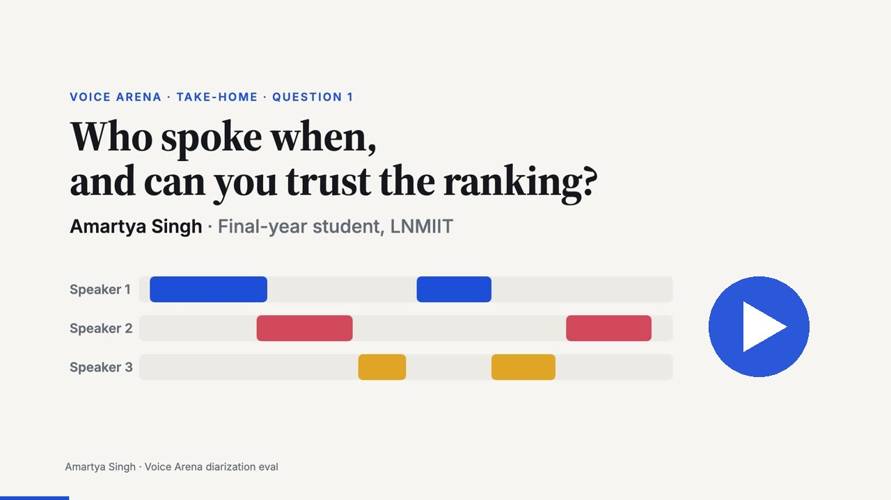
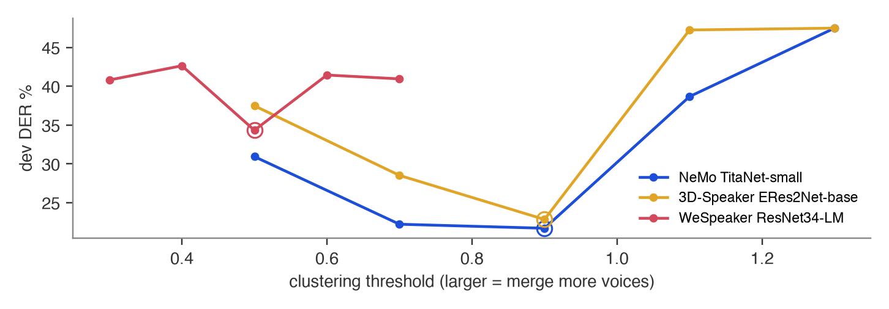
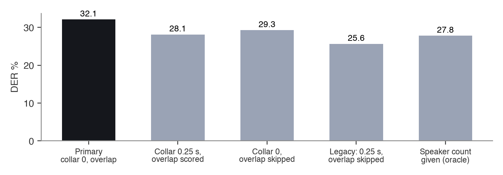
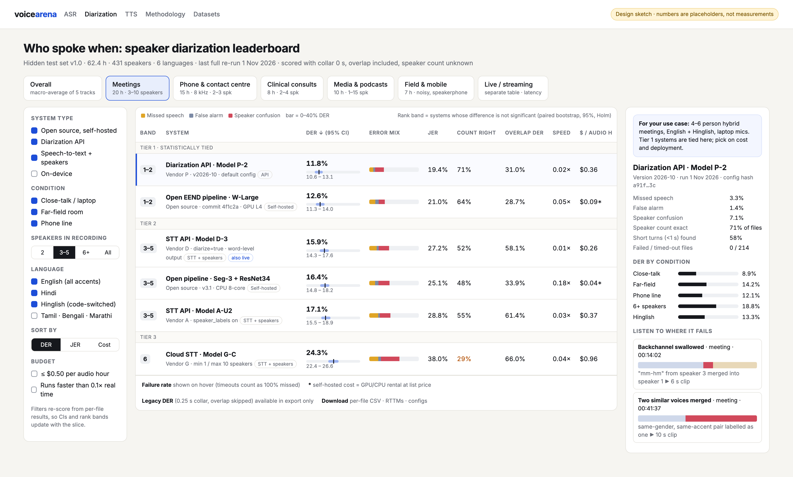

<div align="center">

# Who spoke when, and can you trust the ranking?

**An evaluation design for Voice Arena's public speaker diarization leaderboard, with a reproducible pilot run on public audio.**

Amartya Singh · Voice Arena take-home, Question 1 · November 2026

[**Watch the 2-minute walkthrough**](deliverables/Amartya_Singh_Q1_Video_Walkthrough.mp4) ·
[Main document (PDF)](deliverables/Amartya_Singh_Q1_Main.pdf) ·
[One-pager (PDF)](deliverables/Amartya_Singh_Q1_OnePager.pdf) ·
[Leaderboard sketch](deliverables/Amartya_Singh_Q1_Leaderboard_Sketch.png)

[](deliverables/Amartya_Singh_Q1_Video_Walkthrough.mp4)

</div>

---

## The short version

Speaker diarization answers *who spoke when*. Companies building meeting notes, call analytics, medical scribes and subtitles will use this leaderboard to pick a system, so the design starts from **their decisions**, not from a metric.

| Decision | What I chose | Why |
|---|---|---|
| What gets ranked | **Five use-case tracks** (meetings, phone & contact centre, clinical consults, media, field & mobile) + a **separate live table**. "Overall" = plain mean of tracks. | A system best on clean podcasts can be poor on 8 kHz calls. One global number misleads most buyers. |
| Primary metric | **DER, collar 0 s, overlap scored, speaker count not given**, system's own speech detection | Closest to what a product gets. The legacy 0.25 s collar + skipped overlap hides short turns and crosstalk. |
| Next to every score | Missed / false alarm / confusion, JER, speaker-count accuracy, overlap DER, short-turn recall, WDER for STT systems, speed, $/hour, failure rate | A number has to explain *why* it is that number. |
| Test data | **60 h new hidden recordings** + 9 h public dev, 430+ speakers, English accents + Hindi, Hinglish, Tamil, Bengali, Marathi | Public sets are likely in training data; Indian code-switching is where nobody reports results. |
| Reference | Every speaker also on a **close-talk mic**; forced alignment + human correction; 20% double-annotated; "systems agree, label doesn't" audit | Per-speaker channels make overlap labels trustworthy. Inter-annotator DER is the noise floor. |
| Winning | **Paired bootstrap over recordings**; A beats B only if the 95% CI of the gap excludes 0 and the gap ≥ 0.5 pt (Holm). Shown as **rank bands** ("1–2") | Nobody should buy a winner that only won by chance. |
| Fairness | Same file to everyone, language given, count not given, configs declared before testing, versions pinned + monthly drift check, failed files = 100% missed | Very different system types (open models, APIs, STT with speaker tags, live) on equal terms. |

## Pilot run: what happened on real audio

Three open-source systems (same pyannote segmentation-3.0, different speaker-embedding models, run offline through sherpa-onnx 2.0.3) on 83 minutes of public audio: two AMI test meetings heard three ways (headset mix, far-field array mic, simulated G.711 phone line) plus two VoxConverse clips. Clustering thresholds were tuned on a separate dev split, then frozen.

| System (pyannote-seg-3.0 +) | DER | 95% CI | Missed | False alarm | Confusion | JER | Count exact |
|---|---:|---:|---:|---:|---:|---:|---:|
| **NeMo TitaNet-small** | **32.1** | 27.7–36.7 | 11.3 | 6.1 | 14.7 | 54.1 | 2 / 8 |
| 3D-Speaker ERes2Net-base | 40.5 | 35.4–45.5 | 11.2 | 6.3 | 23.0 | 51.6 | 1 / 8 |
| WeSpeaker ResNet34-LM | 58.9 | 53.7–64.1 | 11.3 | 6.4 | 41.2 | 68.8 | 0 / 8 |

<sub>All in %. Collar 0, overlap scored, speaker count unknown. CI = bootstrap over 60 s blocks. Every pairwise gap is significant (paired bootstrap). pyannote.metrics and dscore agree to 0.00 DER points on all 40 system-file pairs.</sub>

What it taught me:

1. **All the difference was speaker confusion.** Missed speech and false alarms were identical (shared segmentation), so the error mix, not the headline number, tells a builder what to fix.
2. **One config knob beat the model choice.** Default vs dev-tuned threshold moved dev DER by 9–15 points, more than the 8.4-point gap between the two best systems. Configs must be declared and published.
3. **Legacy scoring hid a fifth of the error.** The same TitaNet output: 32.1% (proposed) → 25.6% (0.25 s collar, overlap skipped). Giving the true speaker count: 27.8%.
4. **Single files disagreed with the ranking.** On the 11-speaker clip, ERes2Net beat TitaNet by 10 points. Rank bands over recordings are the guard.

| Dev-set threshold tuning | Settings effect on one output |
|---|---|
|  |  |


## Deliverables

| # | Deliverable | File |
|---|---|---|
| 1 | Main document (purpose, models, data, metrics, process, pilot, final reflection) | [`Amartya_Singh_Q1_Main.pdf`](deliverables/Amartya_Singh_Q1_Main.pdf) |
| 2 | One-page report | [`Amartya_Singh_Q1_OnePager.pdf`](deliverables/Amartya_Singh_Q1_OnePager.pdf) |
| 3 | Leaderboard sketch (PNG + HTML mockup) | [`Amartya_Singh_Q1_Leaderboard_Sketch.png`](deliverables/Amartya_Singh_Q1_Leaderboard_Sketch.png) · [`leaderboard/index.html`](leaderboard/index.html) |
| 4 | Video walkthrough (under 2 min) | [`Amartya_Singh_Q1_Video_Walkthrough.mp4`](deliverables/Amartya_Singh_Q1_Video_Walkthrough.mp4) |
| + | Pilot code, references, raw RTTM outputs, per-file scores | [`eval/`](eval) · [`results/`](results) |



## Repository layout

```
eval/
  prepare.py     build test + dev splits (cut windows, write RTTM/UEM, simulate a phone line)
  systems.py     the three diarization systems (sherpa-onnx, shared segmentation, different embeddings)
  tune.py        pick each system's clustering threshold on the dev split only
  run.py         run a system on a split, write RTTM + timing (unknown or oracle speaker count)
  score.py       DER / JER / parts / overlap DER / short-turn recall / count error + bootstrap CIs + paired tests
  crosscheck.py  re-score everything with dscore and compare
data/
  ref/                official reference RTTMs (AMI only_words, VoxConverse test)
  testset/, devset/   pilot windows: RTTM + UEM per condition (audio is re-downloaded by setup.sh)
results/
  summary.csv  per_file.csv  pairwise.csv  crosscheck.csv
  testset/<system>/<condition>/*.rttm   raw system outputs + run.json (version, threshold, runtime)
  devset/<system>/tuning.json           dev grid and the frozen threshold
docs/
  src/           HTML sources of the PDFs
  build.py       renders charts and PDFs from results/
leaderboard/     HTML mockup of the product
video/           scene page, timeline and mix scripts used to render the walkthrough
deliverables/    the four submission files
```

## Reproduce the pilot

Needs Python 3.12, `ffmpeg`, `git`, Google Chrome (for PDFs) and about 1.5 GB of disk. CPU only, no API keys.

```bash
./scripts/setup.sh      # venv, models, dscore, audio; builds data/testset and data/devset
./scripts/run_all.sh    # tune on dev -> run on test -> score -> cross-check -> build PDFs
```

On an Apple M1 laptop the full run takes roughly two hours, almost all of it speaker-embedding extraction.

## Notes and limitations

- The pilot is small (8 files, 3 systems that share one segmentation model). Its job is to exercise the method and test whether the design choices matter, not to rank products.
- With two AMI meetings and two VoxConverse clips, the pilot bootstrap resamples 60-second blocks rather than whole recordings, which understates uncertainty. The real leaderboard resamples recordings.
- The phone-line condition is simulated (300–3400 Hz band-pass + 8 kHz G.711 μ-law). Real PSTN/VoIP legs add packet loss and codec switching; the proposed test set records real calls.
- Commercial model names in the launch list are the public identifiers as of November 2026; each would be pinned to an exact version string at onboarding.

## Data and licences

AMI Meeting Corpus and VoxConverse are released under CC BY 4.0. References come from the pyannote AMI-diarization-setup and the official VoxConverse repository. Model weights are the ONNX exports published by the sherpa-onnx project, under their original licences.
